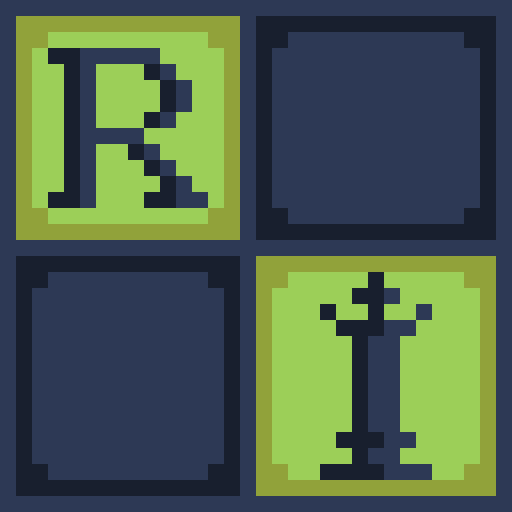

<p align="center">
  
  <br>
  <sup>Designed by <a href="http://swarupgt.thesimple.ink/">Swarup Totloor</a></sup>
</p>

# Ranga

**Ranga** is a UCI-compatible chess engine written in **Go**.

### COPE Rating for *ranga-1.20*
- **Bullet:** 2457 +/- 35
- **Rapid:** 2406 +/- 35

## Building

### Prerequisites

- [Go](https://go.dev/dl/) `1.27.3` or above *(or Docker, if you would rather skip a local install)*
- `make`

### Local build

```bash
make build
```

To target a specific platform:

| Platform      | Command                |
|---------------|------------------------|
| Linux         | `make build-linux`     |
| Mac (Silicon) | `make build-mac`       |
| Windows       | `make build-windows`   |

Without make, build it directly with Go:

```bash
go build -gcflags="all=-B" -ldflags="-s -w" -o bin/ranga ./cmd
```

### Docker

Docker builds the binary inside a container and exports it to the local `./bin` directory.

```bash
make build-docker
```

## UCI Commands

### Standard commands

- `uci`: identify the engine, list options
- `isready`: reply `readyok` when the engine is ready for further commands
- `setoption name <id> value <x>`: set an engine option (see [Options](#options))
- `ucinewgame`: reset the board to the starting position
- `position [startpos | fen <fen>] [moves ...]`: set up the starting position or a position from a FEN string, then plays the given moves
- `go [options]`: start search
  - `depth <n>`: search to specified depth
  - `nodes <n>`: search upto specified nodes
  - `movetime <ms>`: search for specified time (in ms)
  - `wtime <ms>`, `btime <ms>`: time left on clock for both sides
  - `winc <ms>`, `binc <ms>`: time increment for both sides
  - `movestogo <n>`: moves left until next time control
  - `infinite`: keep searching until `stop` is received
  - `perft <n>`: runs perft to depth `n`
- `stop`: stop current search and return current best move
- `quit`: stop search and exit engine

### Options

| Option       | Type   | Description                                 |
|--------------|--------|---------------------------------------------|
| `Hash`       | spin   | transposition table size in MB (default 16) |
| `Clear Hash` | button | clears the transposition table              |

### Non-standard commands

- `eval`: print static evaluation of current position in centipawns
- `show`: print ASCII representation of current board
- `clear`: remove all pieces from board

## Acknowledgements

I want to extend my heartfelt gratitude to the incredible resources and communities that made this journey possible:
- [Vice](https://www.youtube.com/@BlueFeverSoft)
- [Chess Programming](https://www.youtube.com/@chessprogramming591)
- [r/chessprogramming](https://www.reddit.com/r/chessprogramming/)
- [Chess Programming Wiki](https://chessprogramming.org)
- Members of Stockfish Discord Community
